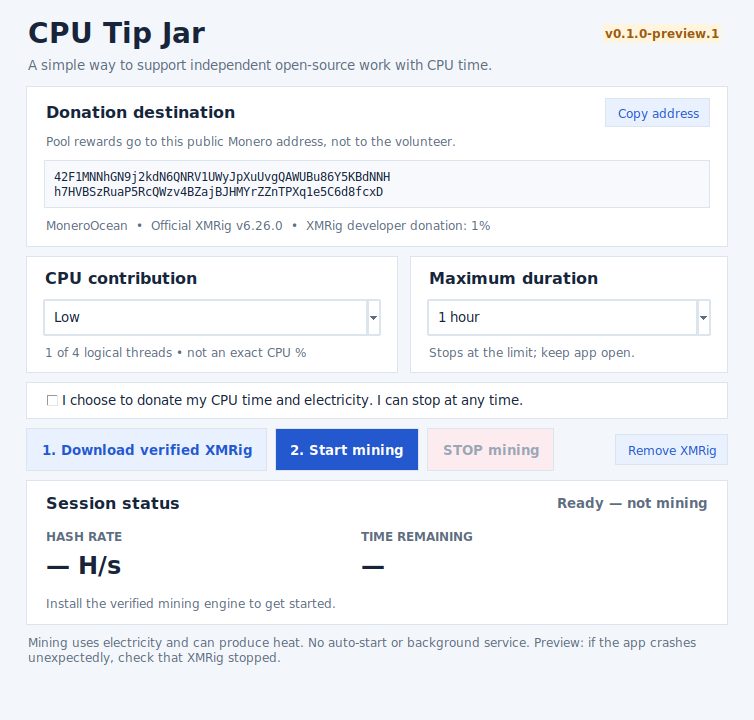

# CPU Tip Jar ⛏️

This started as a pretty dumb idea lol. What if I made a little program that lets random people mine a bit of Monero for me?

I honestly dont expect anyone to actually do it, but I built it anyway and figured I'd throw it online just to see what happens.

It's nothing fancy. You choose how many CPU threads to use and how long it runs, and you can stop whenever.

All the mining rewards go to my wallet, not yours. It also uses your electricity, so that's worth knowing before trying it.

If anyone wants to join my extremely questionable mining empire, you're more than welcome lol.

## What it actually does

CPU Tip Jar is a small, open-source desktop app for **64-bit Linux and Windows**. It uses CPU mining to send Monero pool rewards to the public donation address shown in the app. **This is a donation, not a way for volunteers to earn money.** Electricity costs may be higher than the value donated.

> **Your choice, every time.** CPU Tip Jar does not mine when opened, run hidden in the background, install a service, start with your computer, or disable antivirus. You must explicitly download the mining engine, agree to donate, and confirm Start.

**Latest preview: [v0.1.0-preview.1](https://github.com/dundunna1990/cpu-tip-jar/releases/tag/v0.1.0-preview.1).** The renamed Linux source tests and self-test passed, and the Linux app window was opened and checked. A prior isolated mining session on the underlying code received an accepted pool share and stopped cleanly. Windows automated builds and tests passed on the underlying code, but fresh release downloads and real Windows graphical/antivirus testing still need checking. This remains a **preview**, not a final production release.




## Get started

1. **Download the app** from [Releases](https://github.com/dundunna1990/cpu-tip-jar/releases).
   - **Windows x64:** Download `CPUTipJar-Windows-x64.zip`, extract it, and open `CPUTipJar.exe`.
   - **Linux x64:** Download `CPUTipJar-Linux-x64.tar.gz`, extract it, and run `CPUTipJar` (make it executable if needed). For example: `tar xf CPUTipJar-Linux-x64.tar.gz && ./CPUTipJar`.
2. **Verify the download** against the release's `SHA256SUMS` file.
3. **Download XMRig inside the app.** Click **Download verified XMRig** and confirm. The app retrieves official XMRig v6.26.0, checks pinned SHA-256 hashes, and installs only the miner executable. It does **not** start mining during this step.
4. **Choose your contribution.** Select **Low**, **Medium**, or **High** CPU threads, and a maximum duration of **1 hour**, **1 day**, **10 days**, or **30 days**.
5. **Start only if you want to.** Read the public destination wallet, tick the consent box, click **Start mining**, and confirm.
6. **Stay in control.** Watch the reported hash rate and share messages. Use **STOP mining**, wait for the timer, or close the window normally to stop.

The window must remain open for the duration timer to operate. **Low** is the default (about 25% of logical CPU threads); **Medium** is about 50%, and **High** about 75%. **These are thread counts, not exact CPU-usage limits.** XMRig can also use significant CPU and memory during initialization.

If Windows security software flags the download, **do not disable protection or blindly bypass warnings**. You can review and build the source instead, or make a direct donation.

## Where your donation goes

Mining uses **XMRig** with the **MoneroOcean** pool. Pool rewards are directed to the **public Monero address displayed in the app**, also listed in [DONATIONS.md](DONATIONS.md); volunteers do not receive the mining payouts. Official XMRig has a 1% developer donation. The pool can see your public IP address and submitted mining shares. Anyone who knows the donation address may also be able to look up pool statistics and workers associated with it. Since the donation address is public, people may also be able to look up pool statistics and workers mining to that address. They cannot spend the funds in your wallet with the public address alone.

A **direct Monero donation** is usually much more efficient than running a computer to mine. Both options are appreciated, and neither is required.

## Safety and privacy

- Mining is voluntary and visible. The app has **no autostart, background service, analytics backend, or remote-control interface**.
- CPU mining uses electricity, creates heat, and may increase fan noise and battery drain. Don't run it on a device you don't own or lack permission to use.
- **STOP**, the duration timer, and ordinary window-close end the owned mining process. Version 0.1.0 adds OS-level crash-stop protection: a parent-death signal on Linux and a kill-on-close Windows Job Object. The Linux fake-miner crash test passed, but Windows crash behavior still needs a real-device check. After any abnormal exit, verify that XMRig stopped.
- The app does not need your wallet seed phrase or private keys. It stores no donation earnings ledger.
- **Remove XMRig** deletes the engine executable downloaded by the app. See [SAFETY.md](docs/SAFETY.md) for full limitations, privacy details, and cleanup instructions.

## Build or inspect the source

From source, use **Python 3.10+ with Tkinter**. Linux also requires the common `setpriv` utility from `util-linux` for crash-safe mining. If it is missing, the app refuses to start mining rather than run without the guard. To run the harmless tests:

```bash
python3 -m unittest discover -s tests -v
python3 launcher.py --self-test
python3 launcher.py
```

To package a standalone desktop executable:

```bash
python3 -m pip install pyinstaller==6.16.0
python3 -m PyInstaller --clean --onefile --windowed --name CPUTipJar launcher.py
```

The [build and audit notes](docs/BUILD-AND-AUDIT.md) and [test report](docs/TEST-REPORT.md) explain what was reviewed, what passed, and what still needs real-device testing. GitHub Actions build and test on Linux and Windows **without mining**. Passing CI does not prove that the complete GUI works on every computer.

## Open source and questions

The CPU Tip Jar app is **MIT licensed** (see [LICENSE](LICENSE)). Its separately downloaded mining engine, [XMRig](https://github.com/xmrig/xmrig), is a **GPL-3.0** project with its own licensing and releases. CPU Tip Jar is not affiliated with XMRig or MoneroOcean.

Found a bug or have a suggestion? Open a GitHub issue with the app version, operating system, and steps to reproduce. **Please don't post passwords, wallet keys, or sensitive logs.**

Thanks for checking out this little experiment. ❤️
